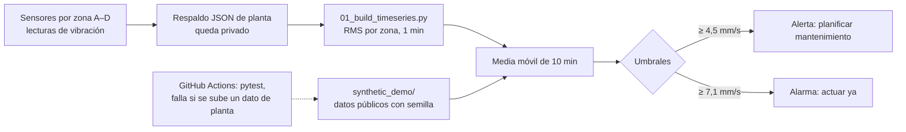

# Análisis de vibraciones para mantenimiento predictivo

> **Caso de estudio en 1 minuto** · [English](README.md)

**Problema de negocio.** En una central hidroeléctrica, un rodamiento o acople de turbina que empieza a fallar lo muestra primero como vibración en aumento. Si nadie ve la tendencia, la central se entera con el disparo: parada no programada, generación perdida y reparación de emergencia. Los operadores reciben miles de lecturas al día y ningún aviso temprano que las priorice.

**Solución.** Convertir las lecturas de vibración en una serie de tiempo por zona (RMS, mm/s), suavizarla y levantar una **alerta** y luego una **alarma** cuando una zona cruza umbrales de estilo ISO, para planificar el mantenimiento antes de la falla.



**Impacto medido (escenario sintético público)**
- **22 h 50 min de aviso anticipado:** en la corrida sintética de 7 días, la zona C cruza la alerta el día 6 a las 18:12 y la alarma recién al día siguiente a las 17:02 ([`synthetic_demo/rms_alarms.py`](synthetic_demo/rms_alarms.py)).
- **0 falsas alertas** en las tres zonas sanas en los mismos 7 días (30.240 minutos-zona).
- **3 pruebas automáticas** en cada push; el CI tarda unos 20 segundos ([workflow](https://github.com/COMPUMAX-EC/hydro-vibration-analysis/actions/workflows/ci.yml)).
- **Los datos de planta no salen de la planta:** JSON, CSV y PNG están en `.gitignore` y el CI falla si alguno aparece.
- Siguiente por medir: detector de anomalías por zona con `darts.ad`, cruzado con la bitácora de mantenimiento.

Los umbrales son ilustrativos, no de una máquina real.

---

## Archivos

- `01_build_timeseries.py`: lee el respaldo JSON, re-muestrea a 1 min por zona y guarda `rms_zone_*.csv` (solo en local).
- `02_plot_zone_a.py`: gráfico general de la zona A (solo en local).
- `synthetic_demo/rms_alarms.py`: RMS sintético por zona con semilla, con una zona que sube; marca cruces de alerta (4,5) y alarma (7,1) sobre una media móvil de 10 minutos.

## Correr la demo pública

```bash
pip install -r requirements.txt
python synthetic_demo/rms_alarms.py   # muestra los primeros cruces por zona
pytest tests
```

No confundir con el lector Modbus ([lector-modbus](https://github.com/COMPUMAX-EC/lector-modbus), medidor PM556x).
