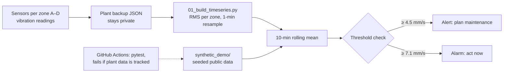

# Vibration analysis for predictive maintenance

> **1-minute case study** · [Español](README.es.md)

**Business problem.** In a hydroelectric plant, a turbine bearing or coupling that starts to fail shows it first as rising vibration. If nobody sees the trend, the plant finds out at the trip: an unplanned stop, lost generation and an emergency repair. Operators get thousands of readings a day and no early warning that ranks them.

**Solution.** Turn the vibration readings into one time series per zone (RMS, mm/s), smooth them, and raise an **alert** and then an **alarm** when a zone crosses ISO-style thresholds, so maintenance is planned before the failure.



**Measured impact (public synthetic scenario)**
- **22 h 50 min of early warning:** in the 7-day synthetic run, the drifting zone C crosses the alert threshold on day 6 at 18:12 and the alarm only at 17:02 the next day ([`synthetic_demo/rms_alarms.py`](synthetic_demo/rms_alarms.py)).
- **0 false alerts** in the three healthy zones over the same 7 days (30,240 zone-minutes).
- **3 automated tests** run on every push; CI takes about 20 seconds ([workflow](https://github.com/COMPUMAX-EC/hydro-vibration-analysis/actions/workflows/ci.yml)).
- **Plant data never leaves the plant:** JSON, CSV and PNG are git-ignored and CI fails if any is tracked.
- Next to measure: an anomaly detector per zone with `darts.ad`, checked against the maintenance log.

Thresholds are illustrative, not from any real machine.

---

## Files

- `01_build_timeseries.py`: reads the plant JSON backup, resamples to 1 minute per zone and writes `rms_zone_*.csv` (local only).
- `02_plot_zone_a.py`: overview plot of zone A (local only).
- `synthetic_demo/rms_alarms.py`: seeded synthetic RMS per zone (mm/s), with one zone drifting upward; flags alert (4.5) and alarm (7.1) crossings on a 10-minute rolling mean.

## Run the public demo

```bash
pip install -r requirements.txt
python synthetic_demo/rms_alarms.py   # prints the first crossings per zone
pytest tests
```

Not to be confused with the Modbus reader ([lector-modbus](https://github.com/COMPUMAX-EC/lector-modbus), PM556x power meter).

## Demo page (synthetic data)

`python synthetic_demo/build_demo_page.py site/index.html` builds a self-contained HTML page (inline SVG, no external assets) with RMS per zone and the alert/alarm thresholds. The `Demo page` workflow builds it on every change and uploads it as the `synthetic-vibration-demo` artifact. No plant data is used.
